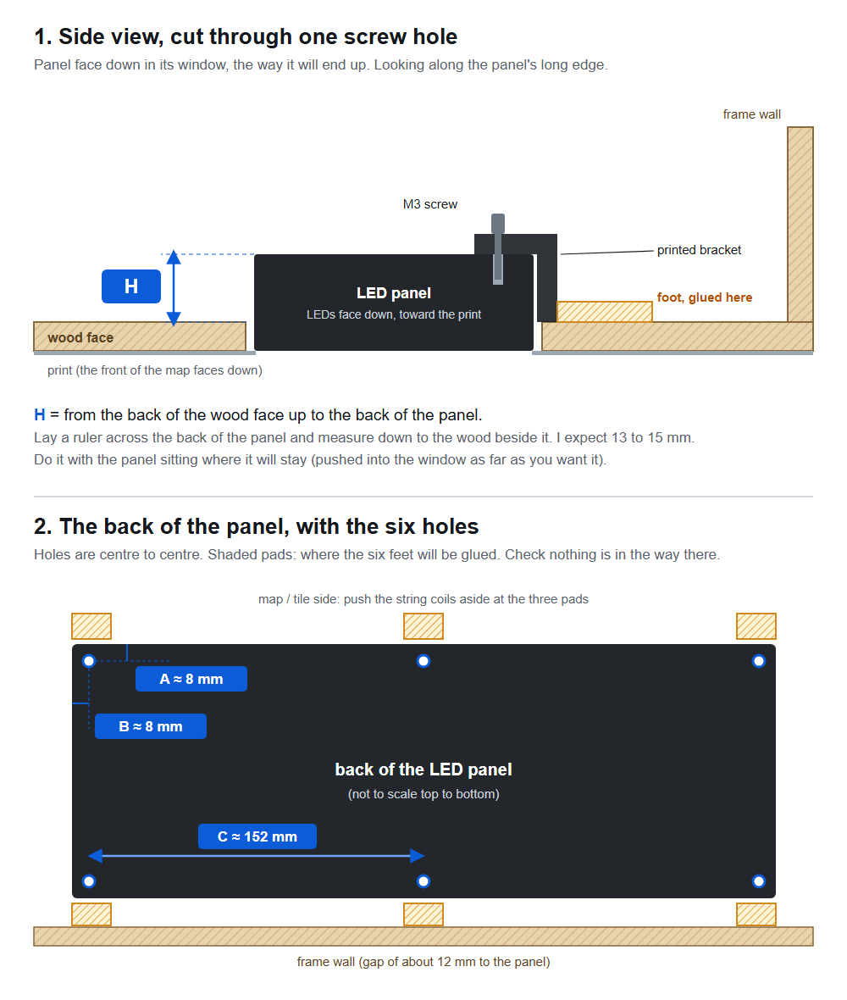
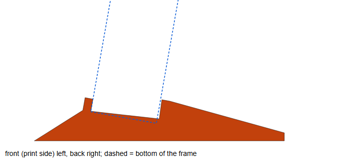

# Build guide

From an empty wood panel to a working display. The steps are grouped by topic; the order to do the
work in, which matters (the print goes on before the pixels, the window is cut before the print),
is in [CHECKLIST.md](CHECKLIST.md). Before any of it, measure your parts ([MEASURE.md](MEASURE.md)).
Do step 1 (the simulator) first even if you never build the rest: later steps use files it creates.

Steps marked **[not done for real yet]** describe the plan, not something already proven on the
finished object. They will be updated as the build goes on. Treat them as a starting point and try
them on scrap first.

Commands are written as `python ...`. Run them from the top folder of the repository with the
virtual environment from the README active.

Contents

1. [Run the simulator](#1-run-the-simulator)
2. [Parts list](#2-parts-list)
3. [Set up the sign](#3-set-up-the-sign)
4. [Set up the light controller](#4-set-up-the-light-controller)
5. [Print the map](#5-print-the-map)
6. [Print the plastic parts](#6-print-the-plastic-parts)
7. [Drill the panel and mount the tiles](#7-drill-the-panel-and-mount-the-tiles)
8. [Wire the lights](#8-wire-the-lights)
9. [Power](#9-power)
10. [Install the electronics and finish](#10-install-the-electronics-and-finish)
11. [The phone remote](#11-the-phone-remote)
12. [Rides: "I'm on the train"](#12-rides-im-on-the-train)

---

## 1. Run the simulator

Follow "Try it in five minutes" in the [README](../README.md). The first start fetches three small
lookup tables from the MBTA (which platform belongs to which station, and the order of stops on
each line) and keeps them in `cache/`. The firmware installer in step 3 needs them.

Then make your own settings file. Copy `config.example.yaml` to `config.yaml` and edit the copy;
`config.yaml` is ignored by git, so your stops and addresses stay on your computer. The sign's two
rows are the part to change first: [Make it yours](MAKE_IT_YOURS.md) shows how to find your stop IDs.

Things to try on the page:

- **Data** menu: live data, or sample scenes (a typical moment, moving trains, every light on).
- **Night mode** checkbox: how the display looks between 11 pm and 7 am.
- **View > Show the holes and the wiring order**: the three wires and every pixel's number.
- http://127.0.0.1:8000/remote : the phone remote (step 11), driving the simulated display.
- http://127.0.0.1:8000/map : the print by itself, with every light's hole if you want them.

---

## 2. Parts list

Everything to buy, and the tools, with the sizes that matter: [PARTS.md](PARTS.md). The printed
parts are in [PRINTED_PARTS.md](PRINTED_PARTS.md).

Power: in normal use the whole thing draws 1 to 2 A. Every light at full white would be about 16 A,
which is why WLED's current limiter is set in step 4.

---

## 3. Set up the sign

This gets the sign working on a desk. It is worth doing before anything is built, because it
proves your Wi-Fi, your API key and your stops.

1. **Install CircuitPython** (version 10 or newer) on the Matrix Portal S3: download the `.uf2` for
   this board from circuitpython.org, double-press the board's reset button, and copy the file onto
   the `MATRXS3BOOT` drive that appears. The board restarts as a drive named `CIRCUITPY`.
2. **Add four libraries.** From the CircuitPython library bundle that matches your version, copy
   `adafruit_requests.mpy`, `adafruit_connection_manager.mpy`, `adafruit_ntp.mpy` and the
   `adafruit_httpserver` folder into the `lib` folder on `CIRCUITPY`.
3. **Plug the board into the panel.** It goes on the panel's *input* socket (the arrows printed on
   the back of the panel point away from it). The panel's red and black power cable goes to the
   board's +5V and GND screw posts.
4. **Install the firmware**, with your board's drive letter or path in place of `D:`:

   ```bash
   python tools/build_firmware.py --deploy D: --secrets
   ```

   `--secrets` asks for your Wi-Fi name and password (2.4 GHz only) and writes them, with the MBTA
   key from `.env`, to `settings.toml` on the board. Nothing is shown on screen or kept on your
   computer. You need `--secrets` only the first time.

The sign shows `WIFI...`, `CLOCK...`, `LOADING...` and then your two rows and the ticker.

Run the same command without `--secrets` whenever you change `config.yaml`, the map or the wiring
plan. To watch what the board is doing, open its serial port at 115200 baud: once a minute it prints
one status line and one line per data source.

| The sign says | It means |
|---|---|
| `WIFI...` and your network's name | Still joining. Check the name and password, and that the network is 2.4 GHz. |
| `NO WIFI / RETRYING` | The network refused it, or is out of range. |
| `NO API KEY` | `settings.toml` has no `MBTA_API_KEY`. Run the install again with `--secrets`. |
| `NO DATA` in the bottom row | Three requests in a row failed. It keeps trying, waiting longer between tries (up to 2 minutes) until the network is back. |

---

## 4. Set up the light controller

The Sparkle Motion runs WLED, a ready-made firmware for LED strings.

1. Install WLED on the Sparkle Motion (Adafruit's guide for the board walks through it) and join it
   to your Wi-Fi.
2. In your router, reserve a fixed address for it. Put that address in `config.yaml` as
   `hardware.wled_ip`. While it says `TODO` the Matrix Portal sends nothing to the map.
3. In WLED, **Config > LED Preferences**, set up three outputs exactly as `data/wled_settings.md`
   lists them: 100 LEDs each, on GPIO 21, 22 and 19, type WS281x.
   - Set the **current limiter** to 3000 to 4000 mA.
   - Color order: plug in one string, set a plain red in WLED, and change the color order until it
     really is red.
4. In **Config > Sync Interfaces**: turn realtime **gamma correction off** (with it on, the
   colors come out darker and off from the ones in the config) and set the realtime **timeout to 20 seconds**. Make the default
   preset dark. Then the map goes dark by itself 20 seconds after the Matrix Portal stops talking.
5. Set WLED's brightness low. 15 out of 255 is what `map.brightness: 0.06` in the config stands for;
   these pixels are far brighter than a backlit map needs.
6. For Music mode on the phone remote, WLED needs a build with sound-reactive effects (the standard
   ESP32 build has them) and the Sparkle Motion's microphone enabled under **Config > Usermods**
   (Audioreactive). Without it the effects run but don't follow the music.
7. Reinstall the firmware (step 3.4, without `--secrets`) so the Matrix Portal knows the address.

With one string plugged into an output, its lights should now come and go with the trains.

---

## 5. Print the map

The print is `data/print_no_outline.svg`, or `data/print_with_outline.svg` if you want a thin line
round the sign window. Both are 610 x 610 mm.

- First, print the test page (`python tools/test_page.py`, then `data/test_page.html` at 100%): downtown
  at full size on one Letter page. Check the 100 mm bar, the label sizes, and how a light shows
  through the paper with the map running.
- Send it to a print shop full size, no scaling. Matte **polypropylene** stays flat on the wood where
  paper waves with humidity. Some shops want a 300 dpi CMYK JPG instead of the SVG: export one at
  7200 x 7200 pixels (24 in at 300 dpi) from a vector editor.
- The file names its font (Arial) instead of containing the letter shapes. Ask the shop to
  **convert the text to outlines**, or do it yourself in a vector editor, so the labels can't shift.

**Before ordering, measure your panel's frame** and put the wall width in `build.yaml` as
`panel.frame_wall` ([MEASURE.md](MEASURE.md)). Every light must sit over the hollow part of the panel, not
over the frame. The map was drawn for walls up to 38.1 mm wide and keeps every light at least 44 mm from
the edges, so it fits any frame up to that, and the generator stops with an error if yours is wider. Mine
measure 20 mm, which leaves about 25 mm between the outermost lights and the frame on three sides, and
40 mm at the bottom: room for wiring. If your walls are wider than 38.1 mm, move the map in first
(`LIGHT_MIN` and `LIGHT_MAX` in `tools/map/params.py`) and regenerate:

```bash
python tools/map/generate.py
```

It writes both prints, `data/stations.csv` and `data/validation_report.md`, and stops with an error
if any rule is broken (a light too near the edge, two lights too close together, a label on top of
a line...). After regenerating, make the wiring plan and the tiles again as well (steps 6 and 8),
because both follow the stations file.

Check the scale of anything you print with a ruler.

---

## 6. Print the plastic parts

The scripts in `hardware/` make every part as an STL file. They need one extra library:

```bash
pip install -r hardware/requirements.txt
```

### What to print

| Command | Makes | For |
|---|---|---|
| `python hardware/make_tile.py lower_left` (and `upper_left`, `upper_right`) | `tile_<name>.stl` | The three tiles that hold all 264 pixels behind the wood. |
| `python hardware/make_parts.py` | `parts_plate.stl`, `portal_cradle.stl`, `sign_parts.stl` | Small parts: a tray for the Sparkle Motion, a cradle for the Matrix Portal, cups for unused pixels, wire clips, zip-tie anchors. `sign_parts.stl` is the sign's bezel, its six brackets and the two feet the map stands on, on one plate; print it in black. |

### Holding the sign

**[printed, not fitted yet]** The panel lies face down on the back of the wood, over its window. Six
printed brackets hold it there, one at each of its M3 threaded inserts (Adafruit's drawing: 7.85 mm in
from the edges, 152 mm apart along the long sides, 144 mm across). Each bracket has a tab over the
insert with a slot, so the screw can land 5 to 13 mm in from the panel's edge; a leg down beside the
panel; and a foot with two prongs underneath that push into a slot in a printed base. The bases are
glued to the wood (E6000, not hot glue), and the prongs grip by friction. The foot reaches 9 mm out
from the panel and runs 26 mm along its edge.

The tabs overlap the sign by at least 12 mm, since they have to reach the inserts, so a bracket glued
straight to the wood would trap the sign for good. With the bases, the sign pulls straight out with
its brackets still on it, and pushes back into the same place.

The fit depends on the printer: on ours the slot prints a little narrower and the prongs a little
wider than drawn, and that is what makes them grip. Print one bracket and one base first. If the
bracket drops in loosely, or won't go in, change `PRONG_HALF` in `make_parts.py` by 0.05 mm at a time.



You need six M3 x 8 mm pan-head screws (have M3 x 6 too, in case the inserts are shallow) and six M3
washers, which hold the screws firmly in their slots. Panels sold since 2020 come without screws.

To fit them: put the bezel on first. Screw each bracket loosely to the sign, and push a base onto
each foot's prongs. Lay the sign face down over its window and square it up from the front: turn on
**Alignment rings** on the phone remote (or in the simulator), which lights the sign's outermost ring
of LEDs white and the next ring yellow. Square, an even half-row of white shows on all four sides of
the bezel's opening; on a side that's off you see all of the white, or some yellow. Then glue the
bases, and leave them a day before moving the panel. Point the
long end of each foot wherever there is room. If the panel ends up upside down, set `sign.rotation: 180`
in `config.yaml` and install the firmware again.

The bezel is a black frame, 3 mm thick, glued on the front round the print's window. It reaches 3 mm
outside the window (DEPARTURES is 4.3 mm above it) and 1.25 mm inside, over about half of the sign's
outermost LEDs, so it covers the cut edges of the paper and the wood. Glue it with 3M 300LSE tape or a mist of
spray adhesive; most glues don't hold on a polypropylene print.

### The tiles

A tile is a lattice of double collars, one per station, joined by flat ribs. Each collar holds a
station's two pixels exactly 14 mm apart, pointing at the wood. Beside every hole is a small plate
with the pixel's number and one, two or three dots for its output, so wiring is a matter of pushing
pixel 0, 1, 2... into the holes marked 0, 1, 2... Neighboring tiles click together with a knob and
a socket so they can only go one way.

Print them in **black**, floor side down. Sizes:

| Tile | Size | Filament | Time on my printer |
|---|---|---|---|
| lower_left | 142 x 166 mm | 86 g | about 5 hours |
| upper_left | 287 x 388 mm | 216 g | about 13 hours |
| upper_right | 286 x 363 mm | 218 g | about 13.5 hours |

The two big tiles need a large bed. They were printed on a 400 x 400 mm bed (an Anycubic Kobra
Max); the upper-left one only fits turned 15 degrees. On a smaller printer you would have to
change the `TILES` table in `make_tile.py` to cut the map into more pieces.

Settings used: PLA, 0.28 mm layers, 0.6 mm lines, two walls, no supports.

The collars are sized for 12 mm WS2811 bullet pixels: a 13.0 mm bore (12.0 to 12.6 gripped too
tight) and 15 mm walls. If your pixels differ, change `pixels.bore` and `pixels.collar_depth` in
`build.yaml`, then run

```bash
python hardware/make_tile.py check
```

which builds all three tiles, confirms that no two of them collide, and says whether each fits your printer's bed.

---

## 7. Drill the panel and mount the tiles

There are 264 holes and each has to line up with a station on the print to within about a
millimeter. They are drilled through a full-size paper guide laid inside the frame.

```bash
python tools/drill_guide.py
```

writes the map seen from behind, the size of the opening in the back of the panel, with a cross at
each of the 264 holes: `data/drill_guide_back.svg`, one sheet for a print shop, and
`data/drill_guide_back_pages.html`, the same on nine Letter pages to print at home. Print at
exactly 100% ("Actual size").

The guide is sized from `panel.size` and `panel.frame_wall` in `build.yaml`: here 609.6 mm outside with
a frame 20 mm wide, so an opening of 569.6 mm. Measure yours first and put your numbers there
([MEASURE.md](MEASURE.md)) so that the sheet drops in snugly. To cover some other area, give its edges
in mm on the command line: `python tools/drill_guide.py x0 y0 x1 y1`.

1. If you printed pages, tape them together on a table, laying the faint blue 50 mm lines of one
   page on those of the next.
2. Check the scale with a ruler: 500.0 mm from the line marked 50 to the line marked 550, across
   and down, and equal diagonals.
3. Lay the sheet inside the frame and tape it down. Either let a snug fit against the walls place
   it, or, to place it exactly, first drill two or three of the ringed reference holes from the
   front (their positions are printed on the sheet) and pin the sheet through them. A small
   uniform shift does no harm: the print goes on last and is slid into place over the lit holes.
4. Drill a 1/8 in pilot hole at every cross, from the back.
5. Turn the panel over and drill the finished 1/4 in holes from the front.
6. **Glue the tiles down.** Each tile's two locating collars, marked by a slot across the rim, sit
   over the ringed reference holes. Check that every hole is near the middle of its collar's
   opening, then fix the tile with E6000 or clear silicone: a dab pressed through each round glue
   tab and a short bead along some ribs. Neighboring tiles click together at their joints.
7. **Cut the sign window** through the wood before the paper goes on: 315.5 x 156.75 mm, its top
   left corner 261.15 mm from the left edge and 419.9 mm from the top. That's about 13 mm from the
   frame wall on the right and bottom, and 14 mm from the nearest tile on top. The template,
   `python tools/sign_template.py`, is two Letter pages that need no trimming: print
   `data/sign_window_template.html` at 100%, push the corner page into the panel's bottom right
   corner with its paper edges flush with the wood, lay the left page over it with its right edge on
   the blue line, and tape both down. Check that the red line is 32.95 mm from the right and bottom
   edges. Drill a 3/8 in starter hole inside each corner, then cut along the red line from the
   front with a jigsaw. The blade reaches well behind the face, so take any pixels near the sign out
   of their holes first. Cutting a millimeter or two too big is fine: the print and the bezel cover
   the edge.

The finished hole is 1/4 in (6.35 mm), a little wider than the 6 mm opening in the tile's floor
that the light comes through. The paper is not cut; it glows where a light is on.

---

## 8. Wire the lights

Nothing is cut or soldered: six strings plug end to end in pairs, one pair on each of the Sparkle
Motion's three outputs.

`data/wiring_plan.csv` lists every pixel in order. Each output's chain runs out along a line taking
one light at every station, and comes back taking the other, so the wire never crosses itself.

1. Print the wiring sheet. It is the panel seen from behind, full size, on twelve Letter pages:

   ```bash
   python tools/wiring_sheet.py
   ```

   Open `data/wiring_back_view.html` and print at 100%.
2. For each output, start with pixel 0 of the string (the one nearest its plug) and push pixels
   into the holes in number order. The numbers on black tiles are hard to read, so use the pixel
   placer as well: `python tools/pixel_placer.py`, then open `data/pixel_placer.html` on a phone or
   laptop. It shows one pixel at a time, its station and its hole on a close-up of the back, and
   remembers where you stopped. Before starting a string, put a piece of tape on every tenth pixel
   (0, 10, 20... and 50, 60... on the second string) and write the number on it: being one off
   partway along is the usual mistake, and it shifts every pixel after it.
3. A row marked **SKIP** is a pixel that lights nothing. Where two lights in a row are further apart
   than the wire reaches, one pixel is left out of the map and parked in a printed cup. There are
   five.
4. When output 1 is done, plug its second string into the end of the first and carry on. Unused
   pixels at the end of a chain stay dark; tuck them away.

**If you wire something differently from the plan** (it happens), don't redo it. Edit
`data/wiring_plan.csv` to say what you actually built, then run

```bash
python tools/wiring_plan.py
```

to check it (every light exactly once, no gaps in the numbering) and install the firmware again.
The code follows the file.

To test, light the pixels one at a time from WLED and check each against the sheet.

---

## 9. Power

One 5 V supply feeds everything. For a step-by-step version with the circuit drawn for each step and
the meter checks, run `python tools/power_guide.py` and open `data/power_guide.html`.

- The supply plugs into the barrel-jack adapter. From its screw terminals, 16 AWG wire goes to the
  two lever nuts: one for 5 V, one for ground.
- From the lever nuts, 20 AWG wire goes to: the sign panel's power cable; the Matrix Portal (through
  the USB-C screw-terminal adapter); the Sparkle Motion (through the barrel-plug pigtail).
- If the far end of a chain looks dim or pinkish next to its start (light every pixel white in WLED
  to compare), also run 5 V and ground to the far end of that output's second string. At the map's
  low brightness it usually isn't needed.

Check polarity twice before plugging in. These parts do not survive 5 V the wrong way round.

---

## 10. Install the electronics and finish

**[not done for real yet]**

- The Sparkle Motion sits on its printed tray, the Matrix Portal on its peg cradle, each held by a
  zip tie. In the finished build the Matrix Portal is beside the sign, not on it, joined to the
  sign's input socket by a 2 x 8 ribbon cable. The lever nuts and the barrel-jack adapter are tied to printed anchors.
- `python hardware/make_hardware_view.py` writes `data/hardware_back_view.html`: the back of the
  panel with the tiles, their joints and a *proposed* place for every part. Change `PLACES` at the
  top of that script to match where things really fit in your panel. The chain starts are 250 mm apart,
  so where the Sparkle Motion sits changes its three leads a lot.
- The sign goes behind its window, face against the wood, held by brackets (see "Holding the sign" in step 6).
- The pixels stand about 40 mm out of the back of the wood, which is as deep as the panel. To hang
  it on a wall it needs spacers of about 10 mm; on a desk, feet.
- Mount the print over the face last (below).
- The stand feet from `sign_parts.stl` stand it on a table, leaning back 10 degrees; they hold the
  outside of the frame only, clear of the pixels.

  

### Mounting the print

The station dots have to sit over the holes, and the adhesive grabs on contact, so the print goes
down one half at a time from a tape hinge across the middle.

**Easiest: order the print adhesive-backed** (self-adhesive matte vinyl or polypropylene; ask the shop
for a "removable" or "repositionable" adhesive if they have one). There is no glue to spray and no
solvent to get trapped, and the 264 holes let air out from under it. Lay it with the hinge below,
peeling the backing as you go and pressing it down with a squeegee or a cloth from the tape outward.

With a print that isn't adhesive-backed, use spray adhesive as follows. **Try it first on an offcut
of the same material glued to scrap wood**, including anything you might do to fix a bubble.

1. Take the pixels out. Wipe the wood free of dust. Cover the sign window from behind with paper.
2. Lay the print on dry with its edges flush on all four sides. Check a few holes in each corner and
   the middle with a light behind them: the dots should light up.
3. Run masking tape across the middle of the print, edge to edge, onto the wood at both ends.
4. For polypropylene: wipe its back with isopropyl alcohol (and scuff it lightly with 320 grit for a
   stronger bond). Use 3M Hi-Strength 90, a contact adhesive: other glues barely hold it.
5. Fold the top half back over the tape. Spray the wood and the back of the print with light, even
   coats, and wait until both are dry to a knuckle's touch, not just tacky: on plastic film the
   solvent can't escape upward, so any left when the two meet becomes bubbles. That can take five
   minutes or more. Then lower the print from the tape outward, rolling it down firmly as you go.
   Take the tape off and do the bottom half.
6. Cut the print's window with a fresh utility blade and a steel ruler, along the black edge, after
   the print is glued down. Glue the bezel over it.

Bubbles: wait a day, as some flatten while the solvent escapes. Prick the rest at their edge with a
pin and press the air out with a fingertip. **Never use heat on the print**, not even a hair dryer
on low: polypropylene shrinks and buckles, and the warm adhesive under it lets go. A ripple that
won't press flat is better left than heated.

---

## 11. The phone remote

The Matrix Portal serves a small web page on your home network. Find the board's address (it shows
on the sign at start-up, under `LOADING...`), reserve it in your router so it never changes, and
open `http://<that address>/` on a phone.

It offers: modes (transit; game night with life totals and a who-goes-first picker; Bruins, which
checks the score every 15 seconds and celebrates goals; off, optionally until a time), brightness
for the sign and the map, a countdown timer, a message for the ticker, "find a station", which
blinks one station's lights, and costume mode, which runs sample trains along every line on the map
(three each way) while the sign carries on as usual.

Costume mode still needs Wi-Fi: the Matrix Portal sends the map to the Sparkle Motion over the
network. Away from home, both boards have to be on the same network, such as your phone's hotspot.

The page is open to anyone on your home network. The calls that change something need a header that only
the page sends (`X-Remote: 1`), so a website you visit can't drive the sign, and the board serves no other
files. To ask for a code as well, add `REMOTE_TOKEN = "your-code"` to `settings.toml`; the page asks for it
once and remembers it. The board is not reachable from outside your network unless you set your router up
to allow that, which you should not do.

---

## 12. Rides: "I'm on the train"

**[works in the simulator and the tests; not yet run on the real board]**

Tell the display which train (or bus) you are on and it follows it. Your train turns purple on the map, and
the ticker shows your name, then the line and the time you will get off (`ALEX`, then `OL 9:36`). A bus shows
on the sign only; the map has no buses. Several people can ride at once, each under their own name.

- **Start** when you get on.
- **Change trains** by starting again with the new train: it replaces your old ride.
- **End** it with End, or let it end by itself: it ends when the train arrives, or after three hours.

There are three ways to tell it, from the simplest to the most flexible.

### From the phone remote (at home, no account needed)

Open the remote's page (step 11). Under **Rides**, type your name (up to eight letters; that phone
remembers it), choose the line, where you get on and where you get off, and tap **Start ride**. The button then
reads **Change train**. Above it is a list of who is riding, with an **End** button for each. The board looks
for the train at its next pause, usually within 20 seconds.

### From anywhere, through Adafruit IO

A phone away from home can't reach the board, so the message goes through a free Adafruit IO feed, which the
board checks every 15 seconds.

1. **Adafruit IO.** Make an account at io.adafruit.com. Create a feed named `mbta-ride`. Under
   **Key** (the key icon) note your username and your key. Keep the key private, like a password.
2. **The board.** Open `settings.toml` on the `CIRCUITPY` drive in a text editor and add two lines:

   ```toml
   AIO_USERNAME = "your-username"
   AIO_KEY = "your-key"
   ```

   The board sends the key to Adafruit IO only. Without these lines it doesn't check the feed.
3. **Bus stops.** `ride.buses` in `config.yaml` names the bus stops a message can use (for the 77:
   Harvard, Porter, Arlington Heights). Find stop numbers with `tools/find_stops.py`; a name can stand for the
   stops on both sides of the street. Reinstall the firmware after changing it.
4. **Send the message.** On an iPhone, make a Shortcut (one on each phone, with that person's name). In the
   Shortcuts app:
   1. **Choose from Menu** with the lines you use: Red, Orange, Green, Blue, Mattapan, 77, and
      **Off the train**.
   2. Under each line: **List** with the stations you get on or off at, spelled as on the map (or
      the bus stop names from step 3); **Choose from List** (prompt "Getting on at"); **Choose from
      List** again on the same list (prompt "Getting off at"); then **Text**:
      `Alex;Orange;` *first chosen item* `;` *second chosen item*.
   3. Under **Off the train**: **Text** `Alex;DONE`.
   4. After the menu: **Get Contents of URL**,
      `https://io.adafruit.com/api/v2/your-username/feeds/mbta-ride/data`, method **POST**, header
      `X-AIO-Key` set to your key, request body **JSON** with one field, `value`, set to the Text.

   Anything else that can send an HTTP POST works the same way, such as an Android app for HTTP requests
   (not tried here), or `curl` from a computer:

   ```bash
   curl -X POST "https://io.adafruit.com/api/v2/your-username/feeds/mbta-ride/data" \
        -H "X-AIO-Key: your-key" -H "Content-Type: application/json" \
        -d '{"value": "Alex;Orange;Ruggles;Downtown Crossing"}'
   ```

### Try it without the hardware

The simulator (README) has a **Rides** panel with the same controls. On live data it follows a real train, as
the board would. On one of the sample scenes (the Data menu) it follows a made-up train, one every five minutes
and about seven minutes from end to end, so you can watch a ride, change trains and end it at any hour, with no
API key and no internet once the first start is done. The purple light moves one stop at a time, and the sign
shows the name, then the line and the arrival time.

### What a message says

`NAME;ROUTE;FROM;TO` starts or changes a ride, and `NAME;DONE` ends it. NAME is up to eight letters or digits.
ROUTE is Red, Orange, Blue, Green or Mattapan, or a bus route listed under `ride.buses`. FROM and TO are stations
spelled as on the map, or bus stop names from the config. Capitals, spaces and punctuation don't matter
(`downtown crossing` works). A message the board can't read is ignored, so if nothing turns purple within a
minute, check the spelling of the stations.

Send it as you get on, not while waiting on the platform: the board picks the train that is at FROM when the
message is sent, or the one that has just left. The phone remote's page sends the same message, as the
`ride` command: post `{"cmd": "ride", "text": "Alex;Red;Harvard;Alewife"}` to `/api/cmd` with the header
`X-Remote: 1`.
